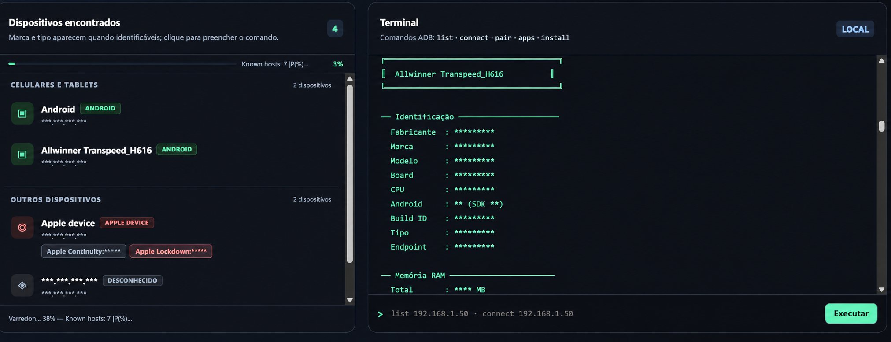

# Android Network

<p align="center">
  **Gerenciamento e manutenção de dispositivos Android TV pela rede local.**
</p>

O **Android Network** é uma ferramenta desenvolvida em Node.js e TypeScript para localizar, conectar e realizar operações de manutenção em Android TVs e TV Boxes pela rede.

O modo oficial de conexão é a **descoberta de dispositivos + ADB**. A partir do painel de descoberta é possível identificar aparelhos e abrir um terminal ADB. A página **Funções** transforma as tarefas de manutenção em um formulário guiado — listar e analisar apps, instalar ou remover APKs, controlar ícones do launcher, capturar a tela, transferir arquivos e reiniciar — com o resultado em um histórico visual de execuções.

A proposta de evolução é tornar a aplicação **inteligente**: no futuro, um **Agent com IA** deverá permitir interação em linguagem natural com o aparelho, interpretando o contexto e executando operações compatíveis com as permissões disponíveis. Esse recurso ainda é um roadmap e não está implementado.

## Prévia da interface

Abaixo estão algumas capturas reais do painel, mostrando a descoberta de dispositivos, o terminal integrado e as ferramentas de manutenção por ADB. Os endereços IP locais foram ocultados nas imagens.

<p align="center">
  
</p>

> **Status do projeto:** em desenvolvimento ativo. A descoberta de dispositivos e o modo ADB já possuem funcionalidades operacionais. O Agent com IA é planejado e ainda não está disponível.

---

## Índice

- [Visão geral](#visão-geral)
- [Funcionalidades](#funcionalidades)
- [Requisitos](#requisitos)
- [Instalação](#instalação)
- [Executando o projeto](#executando-o-projeto)
- [Conectando um dispositivo com ADB](#conectando-um-dispositivo-com-adb)
- [Comandos disponíveis no ADB](#comandos-disponíveis-no-adb)
- [Descoberta de dispositivos](#descoberta-de-dispositivos)
- [Agent com IA — planejado](#agent-com-ia--planejado)
- [Estrutura do projeto](#estrutura-do-projeto)
- [Rede e segurança](#rede-e-segurança)
- [Limitações conhecidas](#limitações-conhecidas)
- [Tecnologias](#tecnologias)
- [Contribuindo](#contribuindo)

---

## Visão geral

A ideia do Android Network é centralizar operações de manutenção de dispositivos Android TV em um painel acessível pelo computador, sem precisar executar manualmente cada tarefa no terminal.

| Módulo             | Objetivo                                                       | Situação                    |
| ------------------ | -------------------------------------------------------------- | --------------------------- |
| Descoberta de rede | Localizar e identificar dispositivos na LAN                    | Implementado — modo oficial |
| ADB                | Executar operações de manutenção nos dispositivos              | Funcional                   |
| Agent com IA       | Permitir interação inteligente e comandos em linguagem natural | Planejado                   |

A página inicial redireciona para `/discovery`, que é o ponto de entrada do modo oficial de conexão.

## Funcionalidades

### Descoberta de dispositivos — modo oficial

O sistema reúne diferentes fontes de informação para localizar dispositivos na rede local:

- Dispositivos ADB conhecidos.
- Descoberta mDNS.
- SSDP / UPnP.
- Serviços relacionados a Cast, Android TV Remote e AirPlay.
- Cache ARP e varredura TCP da sub-rede.
- Identificação por nome, fabricante, modelo e evidências de rede.
- Classificação de dispositivos por tipo e, quando os protocolos fornecem esses dados, por marca/modelo (por exemplo, iPhone, Mac, Samsung/Motorola Android e Android TV/Box).
- Agrupamento visual por contexto — TVs/TV Boxes, celulares/tablets, computadores e rede — mantendo cada IP separado.
- Exclusão de endpoints conhecidos de ambientes virtuais, como aliases Docker e interfaces de containers, para priorizar aparelhos físicos.
- Identificação de dispositivos conectados por USB, quando disponíveis pelo ADB.
- Wake-on-LAN para dispositivos conhecidos.

A descoberta depende dos serviços que cada aparelho disponibiliza na rede. Portanto, nem todo dispositivo será identificado automaticamente.

### ADB — disponível

O módulo ADB permite executar operações diretamente em dispositivos Android autorizados:

- Identificar o dispositivo e consultar informações do sistema.
- Listar aplicativos instalados, incluindo aplicativos de sistema.
- Analisar quais pacotes de sistema podem ser removidos sem afetar boot, configuração e gerenciamento.
- Instalar e atualizar arquivos APK.
- Desinstalar aplicativos, com limpeza automática do ícone no launcher.
- Esconder, mostrar e restaurar ícones de launchers com tiles fixos.
- Capturar a tela do dispositivo.
- Transferir arquivos do computador para a TV Box.
- Reiniciar o dispositivo.
- Conectar, desconectar e parear dispositivos pela rede.
- Manter conexões ADB conhecidas e tentar reconectá-las.

---

## Requisitos

Antes de começar, tenha instalado:

- **Node.js 20 ou superior**
- **npm**, normalmente instalado junto com o Node.js

Para utilizar o módulo ADB:

- Android SDK Platform Tools.
- Executável `adb` disponível no `PATH` do sistema.
- Depuração ADB habilitada e autorização concedida no dispositivo.

---

## Instalação

### 1. Clone o repositório

```bash
git clone https://github.com/vitoralvesdev/android-network.git
```

### 2. Entre na pasta

```bash
cd android-network
```

### 3. Instale as dependências

```bash
npm install
```

### 4. Inicie o servidor em desenvolvimento

```bash
npm run dev
```

O painel será disponibilizado localmente na porta `3000`.

---

## Executando o projeto

Depois de iniciar o servidor, acesse pelo navegador:

| Página              | Endereço                              | Descrição                               |
| ------------------- | ------------------------------------- | --------------------------------------- |
| Descoberta (padrão) | `http://localhost:3000`               | Redireciona para `/discovery`           |
| Descoberta          | `http://localhost:3000/discovery`     | Dispositivos encontrados e terminal ADB |
| Comandos            | `http://localhost:3000/commands.html` | Referência de comandos e capacidades    |
| Configurações       | `http://localhost:3000/settings.html` | Configurações e dispositivos em cache   |

### Acesso pela rede local

Por padrão, o servidor escuta em `0.0.0.0:3000`, permitindo que as páginas sejam abertas por outros dispositivos da rede. A API, porém, continua restrita a requisições locais (veja [Rede e segurança](#rede-e-segurança)).

Para executar somente no próprio computador:

```bash
HOST=127.0.0.1 npm run dev
```

No PowerShell do Windows:

```powershell
$env:HOST="127.0.0.1"; npm run dev
```

Na primeira execução, o Windows pode solicitar autorização para o Node.js no Firewall. Permita o acesso em redes privadas para que os dispositivos da LAN consigam alcançar o servidor.

---

## Conectando um dispositivo com ADB

O ADB é a forma de conexão usada pelas operações de manutenção do projeto.

Existem duas possibilidades principais: conexão USB ou conexão pela rede Wi-Fi/Ethernet.

### Opção 1 — USB

1. Ative as opções do desenvolvedor na TV Box.
2. Habilite a depuração USB.
3. Conecte o aparelho ao computador por USB.
4. Aceite a autorização de depuração exibida na TV.
5. No terminal, execute:

```bash
adb devices
```

O serial do aparelho aparecerá na lista. Esse serial pode ser utilizado como alvo dos comandos do projeto.

### Opção 2 — ADB pela rede

**Android 11 ou superior:**

1. Ative as opções do desenvolvedor.
2. Habilite a opção **Depuração sem fio**.
3. Consulte o endereço e a porta de pareamento exibidos pelo Android.
4. Execute o pareamento:

```text
pair <ip:porta-de-pareamento> <código>
```

5. Depois, conecte usando o endereço e a porta de conexão:

```text
connect <ip:porta-de-conexão>
```

**Android 10 ou inferior:**

1. Habilite a depuração ADB pela rede, quando disponível na firmware.
2. Execute:

```bash
adb connect 192.168.1.20:5555
```

3. Aceite a autorização de depuração exibida na TV, se solicitada.

A disponibilidade dessas opções depende da versão do Android e da firmware instalada pelo fabricante.

### Box antiga (Android 9/10) sem depuração de rede

Muitas TV boxes Allwinner (H6/H616) e Amlogic expõem o ADB apenas pelo cabo. Nesses casos a porta `5555` fica fechada e a descoberta mostra o aparelho como **desconhecido** — não é falta de identificação, é ausência de serviço.

1. Diagnostique o IP:

```text
probe 192.168.1.26
```

O comando testa portas TCP, banners HTTP/RTSP, SSDP/mDNS/NetBIOS, TTL e o fabricante do módulo Wi-Fi pelo MAC. Use `probe <ip> full` para varrer 1–65535.

2. Antes de tentar o cabo, confirme se o PC enxerga alguma coisa:

```text
usb
```

O comando mostra o que o `adb` lista e o que o Windows enumerou (VID/PID, classe e nome), com a diferença em relação à consulta anterior. Rode `usb` sem o cabo, conecte o cabo e rode `usb` de novo: se nada novo aparecer, o cabo é só de carga ou a porta não faz conexão de dados.

3. Com o cabo OTG conectado uma única vez, ligue o ADB de rede:

```text
tcpip <serial-usb>
```

O comando descobre o IP pela shell, executa `adb tcpip 5555`, tenta persistir `persist.adb.tcp.port` quando há root e conecta pela rede. Sem root, a porta volta ao padrão após reiniciar.

4. Sem cabo, as alternativas são console **UART 3,3 V** no header da placa (shell root e `setprop persist.adb.tcp.port 5555`) ou repack da ROM stock com `persist.adb.tcp.port=5555` e flash por cartão SD.

Atenção: muitas caixas H6/H616 só têm portas **USB-A HOST** (2x USB 2.0). Nesse caso nenhum cabo USB liga o aparelho ao PC — não existe porta OTG. Se a porta de depuração for USB-C/micro-USB, um cabo de celular comum (com dados) resolve; se for USB-A rotulada OTG, é necessário um cabo A-A macho-macho.

Se as opções do desenvolvedor tiverem **USB device mode**, deixe-a ativada junto com **Depuração USB**: é ela que coloca a porta OTG em modo dispositivo e permite que o PC enxergue o ADB. Ela não abre a porta 5555 na rede — apenas habilita o ADB pelo cabo. Cabos só de carga não funcionam; teste com um cabo de dados e uma porta USB 2.0 traseira do PC.

Android 11+ com **Depuração sem fio** não existe em ROM stock H6/H616; ROM de H618 não é compatível com H6/H616 e pode brickar a placa.

---

## Comandos disponíveis no ADB

Os comandos podem ser executados pelo terminal da interface `/discovery` ou pelo terminal do sistema, conforme indicado.

| Comando                                                           | Descrição                                   |
| ----------------------------------------------------------------- | ------------------------------------------- |
| `list <ip-ou-serial>`                                             | Consulta informações do dispositivo         |
| `apps <alvo>`                                                     | Lista aplicativos instalados                |
| `analyze <alvo>`                                                  | Classifica o que pode ser removido          |
| `install <alvo> <apk>`                                            | Instala ou atualiza um APK                  |
| `uninstall <alvo> <pacote> confirmar`                             | Desinstala um aplicativo                    |
| `launcher <alvo> [clean\|hide <pacote>\|show <pacote>\|rollback]` | Limpa ícones fixos de apps removidos        |
| `screen <alvo>`                                                   | Captura a tela da TV                        |
| `push <alvo> <arquivo> [destino]`                                 | Envia um arquivo para o dispositivo         |
| `reboot <alvo> confirmar`                                         | Reinicia o dispositivo                      |
| `pair <ip:porta> <código>`                                        | Pareia a depuração sem fio                  |
| `probe <ip> [full]`                                               | Diagnóstico profundo de um IP               |
| `usb`                                                             | Aparelhos no USB e o que o sistema enumerou |
| `tcpip <serial> [porta]`                                          | Converte um aparelho USB em ADB de rede     |
| `connect <ip[:porta]>`                                            | Conecta um dispositivo pela rede            |
| `disconnect <ip[:porta]>`                                         | Encerra uma conexão                         |
| `clear`                                                           | Limpa só a tela do terminal                 |
| `abort`                                                           | Interrompe uma operação compatível          |
| `help`                                                            | Exibe a ajuda de comandos                   |

Exemplo:

```bash
list 192.168.1.20
```

Listar aplicativos:

```bash
apps 192.168.1.20
```

Analisar o que dá para remover sem quebrar a box:

```bash
analyze 192.168.1.20
```

O `analyze` não altera nada: separa os pacotes de sistema em **pode remover** (testes de fábrica, protetores de tela, impressão, galeria, câmera), **revisar** (Google, telefonia, navegador) e **manter** (boot, configurações, launcher, áudio, arquivos, OTA e ADB). Ele mostra o navegador padrão detectado e o comando para reverter um pacote removido com `cmd package install-existing`.

Instalar um APK:

```bash
install 192.168.1.20 ./meu-aplicativo.apk
```

Desinstalar um aplicativo:

```bash
uninstall 192.168.1.20 com.exemplo.aplicativo confirmar
```

Em launchers de fabricante com tiles fixos, o ícone não sai junto com o pacote. Nesses casos o `uninstall` também limpa o ícone automaticamente, e o comando `launcher` permite controlar isso:

```bash
launcher 192.168.1.20            # mostra launcher, tiles e ícones órfãos
launcher 192.168.1.20 clean      # esconde todos os tiles de apps que não existem mais
launcher 192.168.1.20 hide com.google.android.youtube.tv
launcher 192.168.1.20 rollback   # desfaz e volta ao launcher original
```

A limpeza usa um overlay de recursos: o APK do launcher não é alterado e o `rollback` desfaz na hora. No Android 10 o overlay só aplica se estiver assinado com o mesmo certificado do launcher (ou pré-instalado em `/system`) — o HLauncher usa a testkey pública do AOSP, então o programa assina o overlay com ela. Detalhes e o que fazer em outros aparelhos: [docs/hlauncher.md](docs/hlauncher.md).

Aparelhos já testados e o que foi validado em cada um estão na seção [Dispositivos validados](#dispositivos-validados).

O alvo pode ser um endereço IP, um endereço com porta ou o serial USB exibido pelo `adb devices`.

### Dispositivos validados

Catálogo dos aparelhos testados com o Android Network. A homologação é feita em etapas, da mais básica para a mais invasiva:

| Etapa | O que valida                                                |
| ----- | ----------------------------------------------------------- |
| 1     | `list` encontra o aparelho e `connect` abre o ADB           |
| 2     | `apps`, `screen`, `push` e `install` funcionam              |
| 3     | `uninstall` remove o pacote e o ícone some da tela          |
| 4     | Limpeza de ícones estáticos de pacotes que não existem mais |

#### Homologados

**Transpeed 6K Ultra (H616)**

| Campo            | Valor                                                                                        |
| ---------------- | -------------------------------------------------------------------------------------------- |
| Modelo reportado | `Transpeed_H616`                                                                             |
| Android          | 10                                                                                           |
| Etapa            | 1 a 4 — `list`/`connect`, `apps`/`screen`/`push`/`install`, `uninstall` + limpeza automática |
| Observações      | ADB de rede só existe depois de `tcpip 5555` e volta a cair a cada reboot                    |

**Samsung Galaxy S20**

| Campo    | Valor                     |
| -------- | ------------------------- |
| Modelo   | Galaxy S20                |
| Android  | não registrado            |
| Conexão  | ADB (USB)                 |
| Etapa    | 1 — `list` + `connect`    |
| Launcher | dinâmico (padrão Samsung) |

#### Parcialmente validados

**Android TV original (marca não identificada)**

| Campo                       | Valor                                                 |
| --------------------------- | ----------------------------------------------------- |
| Modelo                      | não identificado (teste feito em outro notebook/rede) |
| Android                     | não registrado                                        |
| Conexão                     | ADB pela rede local                                   |
| Etapa                       | 1 — `list` + `connect`                                |
| `uninstall` remove o ícone? | **Sim** — o ícone sumiu da tela logo após a remoção   |

Esse resultado mostra que o comportamento depende do launcher: em Android TV com launcher dinâmico o ícone acompanha o pacote; em launchers de fabricante com tiles fixos, não.

#### Como homologar um aparelho novo

1. Rode `usb` e `list <ip>` para confirmar a etapa 1.
2. Rode `apps <ip>` e `screen <ip>` para a etapa 2.
3. Instale um APK de teste, remova com `uninstall <ip> <pacote> confirmar` e confira a tela.

### Funções guiadas

A página `/functions.html` concentra as operações de manutenção em um único formulário. Em vez de digitar comandos, você escolhe a função em uma lista e preenche apenas os campos daquela operação:

- Diagnóstico: identificar aparelho, analisar o que pode ser removido, diagnóstico de rede e dispositivos no USB.
- Conexão: conectar, desconectar, parear e ativar o ADB por rede a partir do USB.
- Apps: listar, instalar APK, remover e controlar os ícones do launcher.
- Tela e arquivos: capturar a tela e enviar arquivos.
- Sistema: reiniciar a box.

Cada execução entra no painel **Atividade**, no estilo de um log (horário, status, duração e saída), com filtro, cópia da saída e preview das capturas de tela. O alvo pode ser digitado ou escolhido entre os dispositivos já encontrados pela descoberta.

As operações dependem de ADB habilitado e autorizado no dispositivo.

---

## Descoberta de dispositivos

A descoberta procura identificar aparelhos disponíveis na rede local usando diferentes protocolos e sinais.

O processo considera:

- Hosts já conhecidos.
- Dispositivos listados pelo ADB.
- Serviços mDNS.
- SSDP / UPnP.
- Serviços Cast, Android TV Remote e AirPlay.
- Cache ARP.
- Varredura TCP da sub-rede principal.
- Informações obtidas por HTTP, DNS reverso e TTL, quando disponíveis.

Os resultados são agrupados e classificados com base nas evidências encontradas.

A API de dispositivos combina as informações da descoberta com os aparelhos ADB conectados por USB.

---

## Agent com IA — planejado

A evolução do projeto é tornar a aplicação **inteligente**, permitindo que o usuário converse com o dispositivo de maneira mais natural.

Em vez de depender exclusivamente de comandos técnicos, a intenção é desenvolver um agente capaz de interpretar solicitações, entender o contexto do aparelho e executar operações compatíveis com as permissões disponíveis.

**Importante:** esse recurso é apenas um roadmap. A estrutura atual do projeto é composta por descoberta de dispositivos, terminal ADB e operações de manutenção. Não há integração com IA implementada nesta versão.

---

## Estrutura do projeto

A organização é modular: servidor, funcionalidades centrais, descoberta, ADB e interface web ficam separados.

```text
src/
├── server.ts                 # Inicialização do Express e montagem das rotas
├── capabilities.ts           # Mapa de capacidades da aplicação
│
├── core/
│   ├── settings.ts            # Configurações gerais, porta, host e diretórios
│   ├── log.ts                 # Barramento de logs e eventos SSE
│   ├── routes.ts              # Rotas centrais de API
│   ├── security.ts            # Verificação de requisições locais
│   ├── config-store.ts        # Persistência das configurações
│   ├── host-cache.ts          # Cache de dispositivos conhecidos
│   ├── network.ts             # Interfaces, ARP, DNS, TTL e portas
│   ├── wol.ts                 # Wake-on-LAN
│   └── http.ts / xml.ts /
│       text.ts / time.ts      # Utilitários
│
├── discovery/
│   ├── scan.ts                # Orquestração da descoberta
│   ├── identify.ts            # Identificação e classificação
│   ├── models.ts
│   ├── ports.ts
│   ├── types.ts
│   ├── protocols/             # mDNS, SSDP, AirPlay e Cast
│   └── routes.ts              # Endpoints da descoberta
│
└── adb/
    ├── analyze.ts             # Classificação de pacotes seguros para remoção
    ├── client.ts              # Cliente ADB e resolução de alvos
    ├── ops.ts                 # Operações de manutenção
    ├── keepalive.ts           # Reconexão e monitoramento
    └── routes.ts              # Comandos, transferências e capturas

public/
├── discovery.html             # Descoberta e terminal (página inicial)
├── functions.html             # Funções guiadas com histórico de execuções
├── commands.html              # Referência de comandos
├── settings.html              # Configurações
└── js/
    ├── common.js
    ├── capabilities.js
    ├── functions.js
    └── discovery.js
```

A estrutura acima representa os módulos documentados. Arquivos adicionais podem existir no repositório.

---

## Rede e segurança

O servidor utiliza a porta `3000` por padrão e escuta em `0.0.0.0` para permitir que as páginas sejam acessadas pela rede local.

As regras de acesso atuais são:

- As rotas `/api/*` são restritas a requisições locais (o próprio computador que executa o servidor).
- As páginas estáticas podem ser abertas por outros dispositivos da rede, mas as chamadas de API feitas por eles recebem `403`.
- O terminal e as operações de manutenção dependem do ADB habilitado e autorizado no aparelho.

**Atenção:** não exponha o servidor diretamente à internet. A configuração foi pensada para uso local em uma rede confiável.

---

## Limitações conhecidas

- Não existe um método universal para identificar toda TV Box apenas pelo endereço IP.
- Dispositivos desligados, em outra sub-rede ou sem serviços de descoberta ativos podem não aparecer.
- A descoberta depende dos protocolos e serviços disponibilizados pela firmware.
- Alguns aparelhos não anunciam um nome na rede; MACs privados/aleatórios também impedem identificar o fabricante pelo endereço. Nesses casos, o nome pode estar disponível apenas na lista de clientes DHCP do roteador ou nas configurações do próprio aparelho.
- O ADB exige autorização no aparelho antes de permitir operações.
- Algumas fabricantes bloqueiam ou modificam opções de desenvolvedor e depuração.
- A API é restrita ao computador que executa o servidor; outros dispositivos da LAN conseguem abrir as páginas, mas não chamar a API.
- O Agent com IA ainda não está implementado.

Se a firmware bloquear as opções de desenvolvedor, pode ser necessário utilizar um menu de engenharia ou ferramentas específicas do fabricante.

---

## Tecnologias

- **Node.js**
- **TypeScript**
- **Express**
- **Android Debug Bridge (ADB)**
- **HTML, CSS e JavaScript**
- **Protocolos de descoberta de rede:** mDNS, SSDP / UPnP e outros

---

## Contribuindo

Contribuições, testes em diferentes modelos de TV Box e relatos de compatibilidade são bem-vindos.

Para contribuir:

1. Faça um fork do repositório.
2. Crie uma branch para sua alteração.
3. Implemente e teste a mudança.
4. Envie um Pull Request explicando o que foi alterado e como testar.

Ao reportar um problema, inclua, sempre que possível:

- Modelo da TV Box.
- Versão do Android e firmware.
- Tipo de conexão (Wi-Fi, Ethernet ou USB).
- Logs e mensagens de erro relevantes.

---

## Licença

Consulte o arquivo `LICENSE` do repositório para informações sobre os termos de uso e distribuição.
